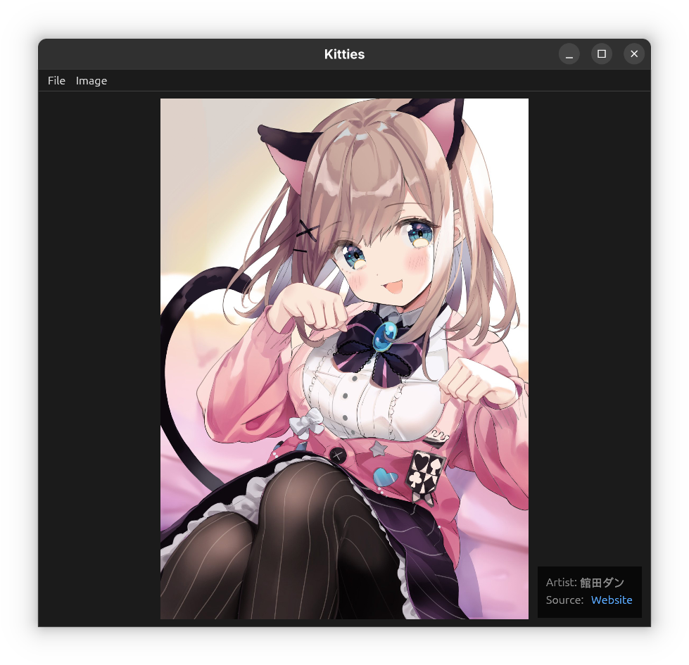

# Kitties
Simple GUI app to look at cartoon women with feline features.

# Showcase


# Shortcuts
Instead of navigating the menubar, you can use some handy keyboard shortcuts!

Save Image: Ctrl+Shift+S

New Image: Ctrl+N

# Building
First, you will need git and rust.

You can install rustup [here](https://rustup.rs/).

Next, you need to install git.
```bash
# Windows
winget install --id Git.Git

# Linux
# Ubuntu/Fedora
sudo apt install git
sudo dnf in git

# Arch
sudo pacman -S git
```

Now, we can compile the app.
```bash
git clone https://github.com/hexedrevii/kitties
cd kitties

cargo build --release
```

## Setting up the app
### Linux
```bash
cd resources/

sudo mkdir -p /usr/local/share/kitties
sudo cp ../target/release/kitties /usr/local/share/kitties
sudo cp ./kitties.desktop /usr/local/share/applications/
sudo cp ./icon.png /usr/local/share/kitties
```

### Windows
soon :(

# LICENSE
GPL 3.0
